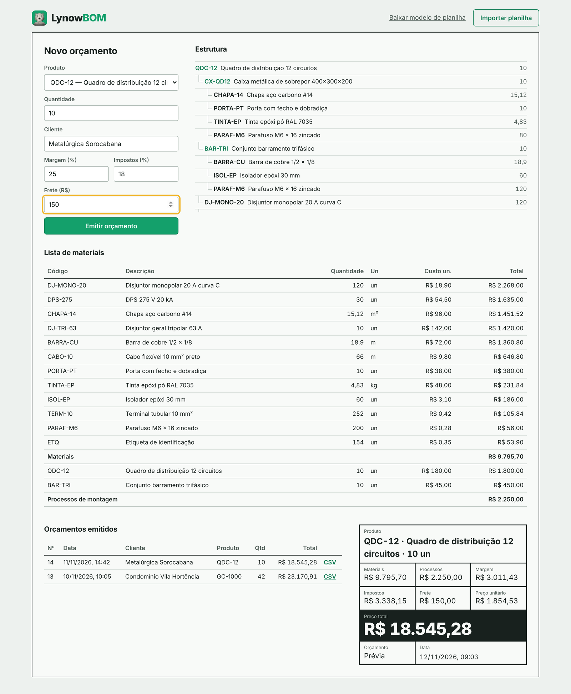
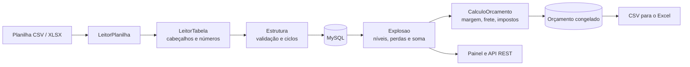

<p align="center"><sub>LynowBOM</sub></p>

---

<p align="center">
  
</p>

<p align="center">
  Da planilha de engenharia ao orçamento: a lista de materiais multinível calculada, somada e com preço — sem retrabalho manual.
</p>

<p align="center">
  
  
  
</p>

> [!TIP]
> Quer ver funcionando sem instalar banco? Rode no perfil **demo**: `mvn spring-boot:run -Dspring-boot.run.profiles=demo` e abra `http://localhost:8080`. Uma estrutura de exemplo já vem carregada.

## Sobre o projeto

Em empresas de engenharia, a estrutura de um produto costuma viver numa planilha: um quadro elétrico leva uma caixa metálica, que leva chapa, porta e tinta; o mesmo parafuso aparece em três montagens diferentes; cada material tem uma perda de corte ou de aplicação. Na hora de orçar 10 unidades, alguém multiplica tudo à mão, soma o que se repete, esquece um nível e descobre o erro depois do pedido fechado.

O LynowBOM transforma essa planilha em um configurador. Você importa o arquivo do jeito que a engenharia já trabalha, escolhe o produto e a quantidade, e o sistema explode a estrutura em todos os níveis, aplica as perdas, consolida os materiais repetidos e forma o preço com margem, frete e impostos. O orçamento emitido guarda uma cópia dos custos do dia, então mudar o preço de um item amanhã não altera o que já foi enviado ao cliente.

<p align="center">
  
</p>

## Principais recursos

| Recurso | Como funciona |
|---|---|
| Importação de planilha | CSV (separado por `;` ou `,`, UTF-8 ou Windows-1252) e XLSX. Aceita cabeçalhos com acento e sinônimos como "Qtd", "Item pai" e "Refugo %". |
| Explosão multinível | Percorre toda a árvore do produto, multiplicando as quantidades de cada nível pela quantidade do pedido. |
| Perda por ligação | Cada componente pode ter sua perda (corte de chapa, sobra de cabo, tinta); a quantidade final já sai acrescida. |
| Consolidação | O mesmo material em montagens diferentes vira uma única linha, com a quantidade somada. |
| Custo de processo | O custo informado numa montagem representa mão de obra e processo, separado do custo de materiais. |
| Validação antes de gravar | Ciclos na estrutura (A → B → A), quantidades zeradas, ligações duplicadas e números inválidos são apontados por linha. Nada é gravado se houver erro. |
| Formação de preço | Margem sobre o custo, frete e impostos calculados por dentro, como na nota fiscal. |
| Orçamento congelado | Cada orçamento guarda uma cópia das linhas e custos do momento da emissão. |
| Exportação | Lista de materiais do orçamento em CSV pronto para abrir no Excel em português. |

## Tecnologias

<p>
  
  
  
  
  
  
  
  
</p>

### Back-end

- **Java 21** com records para o modelo de cálculo;
- **Spring Boot 3** (Web, Validation) para a API REST e as respostas de erro no padrão RFC 7807;
- **Spring Data JPA** sobre **MySQL 8**, com **H2** em memória no perfil de demonstração;
- **Apache POI** para ler planilhas XLSX sem depender do Excel instalado;
- `BigDecimal` em todo o cálculo: quantidades com 6 casas, valores com 2, arredondamento `HALF_UP`.

### Painel web

- HTML, CSS e JavaScript sem framework, servidos pelo próprio Spring;
- prévia do preço enquanto os campos são editados, com a mesma fórmula do servidor;
- resumo do orçamento desenhado como o **carimbo** de uma folha de desenho técnico.

### Infraestrutura

- **Dockerfile** em duas etapas (Maven → JRE) e **docker-compose** com MySQL e volume persistente;
- **GitHub Actions** compila, roda os testes e publica o `.jar` como artefato a cada push.

## Arquitetura



O pacote `core` não conhece Spring nem banco de dados: recebe linhas, monta a estrutura, explode e calcula. Os serviços apenas carregam do banco, chamam o núcleo e gravam o resultado. Isso deixa as regras de cálculo testáveis isoladamente e fáceis de reaproveitar em outro front-end.

## Formato da planilha

A primeira linha é o cabeçalho. Linhas com `pai` vazio são os produtos; as demais dizem "este código entra neste pai, nesta quantidade".

| pai | codigo | descricao | quantidade | unidade | custo_unitario | perda_% |
|---|---|---|---|---|---|---|
| | QDC-12 | Quadro de distribuição 12 circuitos | 1 | un | 180,00 | |
| QDC-12 | CX-QD12 | Caixa metálica 400×300×200 | 1 | un | | |
| QDC-12 | CABO-10 | Cabo flexível 10 mm² | 6 | m | 9,80 | 10 |
| CX-QD12 | CHAPA-14 | Chapa aço carbono #14 | 1,35 | m² | 96,00 | 12 |

Colunas obrigatórias: `pai`, `codigo`, `descricao`, `quantidade`. O modelo completo pode ser baixado pelo painel ou em `GET /api/modelo.csv`.

Ao importar, as montagens presentes no arquivo têm sua estrutura **substituída**; as que não aparecem continuam como estavam. Assim dá para atualizar um conjunto sem reenviar o catálogo inteiro.

## API

| Método | Rota | Uso |
|---|---|---|
| `POST` | `/api/importacoes` | Envia a planilha (`multipart/form-data`, campo `arquivo`). |
| `GET` | `/api/produtos` | Produtos de topo disponíveis para orçamento. |
| `GET` | `/api/itens` | Catálogo completo de itens. |
| `GET` | `/api/produtos/{codigo}/explosao?quantidade=10` | Árvore, materiais consolidados, processos e avisos. |
| `POST` | `/api/orcamentos` | Emite um orçamento a partir de produto, quantidade, margem, impostos e frete. |
| `GET` | `/api/orcamentos` | Últimos 50 orçamentos. |
| `GET` | `/api/orcamentos/{id}/materiais.csv` | Lista de materiais do orçamento para o Excel. |

Exemplo de emissão:

```bash
curl -X POST http://localhost:8080/api/orcamentos \
  -H "Content-Type: application/json" \
  -d '{"produto":"QDC-12","quantidade":10,"cliente":"Cliente exemplo","margemPercentual":25,"impostosPercentual":18,"frete":150}'
```

## Estrutura do repositório

```text
LynowBOM/
├── src/main/java/com/arthurentsev/lynowbom/
│   ├── core/                     Cálculo puro: leitura, estrutura, explosão e preço
│   ├── dominio/                  Entidades JPA e repositórios
│   ├── servico/                  Importação, catálogo e orçamentos
│   └── web/                      API REST e tratamento de erros
├── src/main/resources/
│   ├── static/                   Painel web
│   ├── exemplos/                 Planilha de exemplo
│   └── application.yml           Perfis padrão (MySQL) e demo (H2)
├── src/test/java/                Testes do núcleo e da API
├── assets/                       Banner, mascote e captura do painel
├── .github/workflows/ci.yml      Testes e build automáticos
├── Dockerfile
├── docker-compose.yml
└── PRODUTO.md                    Direção do produto e próximos passos
```

## Executando o código

### Demonstração (sem banco)

Requisitos: Java 21 e Maven 3.9.

```bash
mvn spring-boot:run -Dspring-boot.run.profiles=demo
```

No Windows, `INICIAR.bat` faz o mesmo e abre o navegador.

### Com MySQL via Docker

```bash
docker compose up --build
```

O painel fica em `http://localhost:8080` e os dados persistem no volume `lynowbom-dados`.

### Com um MySQL existente

```bash
export DB_URL="jdbc:mysql://localhost:3306/lynowbom?createDatabaseIfNotExist=true"
export DB_USER=usuario DB_PASSWORD=senha
mvn spring-boot:run
```

### Testes

```bash
mvn verify
```

Os testes do núcleo conferem a explosão, a consolidação, as perdas, a fórmula de preço e as validações; os de integração sobem a aplicação no perfil demo e percorrem a API.

## Decisões técnicas

- **Núcleo sem framework:** o cálculo vive em `core` com tipos imutáveis, testado sem subir Spring nem banco.
- **Validar tudo antes de gravar:** a estrutura do banco é combinada com a do arquivo e verificada inteira, inclusive ciclos entre arquivos diferentes, antes de qualquer `INSERT`.
- **Orçamento como fotografia:** linhas e custos são copiados no orçamento; o histórico não muda quando o catálogo muda.
- **Planilha do jeito que existe:** separador, codificação, vírgula decimal e cabeçalhos com acento são resolvidos pelo leitor, não pelo usuário.
- **Impostos por dentro:** `preço = custo × (1 + margem) ÷ (1 − impostos)`, o que mantém o percentual de imposto correto sobre o valor final.

## Estado atual

Esta é a versão **0.1.0 alpha**. Importação, validação, explosão multinível, formação de preço, histórico e exportação em CSV estão implementados.

Ainda não há autenticação nem controle de revisões da estrutura: a importação substitui a versão anterior de cada montagem. O esquema do banco é criado pelo Hibernate (`ddl-auto: update`); para produção, o próximo passo é migrar para Flyway. Os próximos passos estão em [PRODUTO.md](PRODUTO.md).

## Documentação

- [Direção do produto](PRODUTO.md)
- [Núcleo de cálculo](src/main/java/com/arthurentsev/lynowbom/core)
- [Testes do núcleo](src/test/java/com/arthurentsev/lynowbom/core/ExplosaoTest.java)
- [Planilha de exemplo](src/main/resources/exemplos/estrutura-exemplo.csv)
- [Identidade visual do banner](docs/BANNER.md)

## Licença

Distribuído sob a [licença MIT](LICENSE).

---

<p align="center"><sub>Estudo · construção · evolução</sub><br><a href="https://github.com/arthurlynow098">Perfil</a> · <a href="https://arthurentsev.vercel.app/">Portfólio</a></p>
